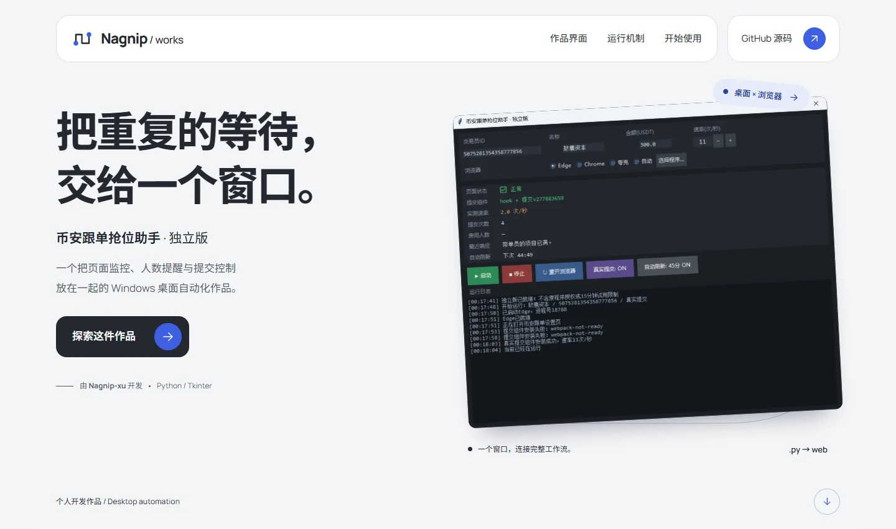
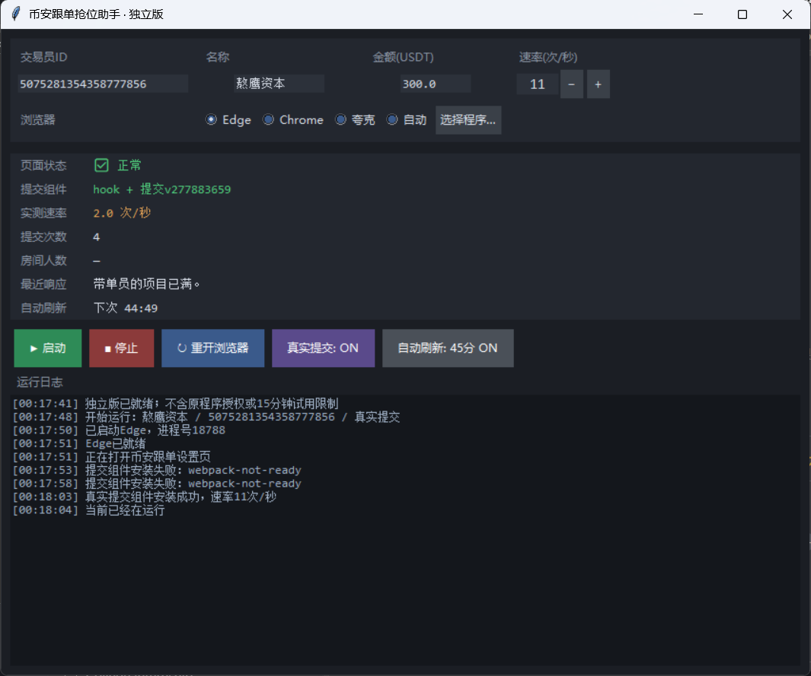
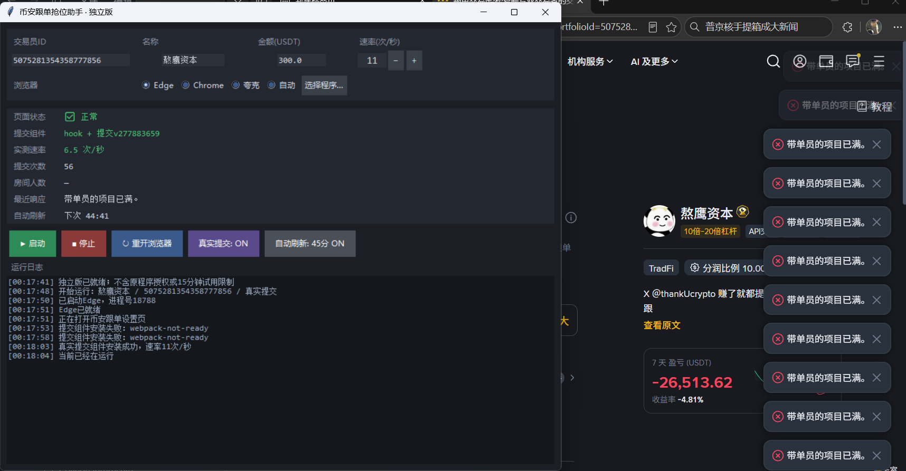
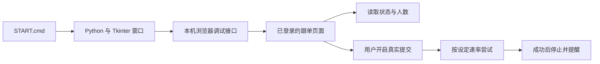

<div align="center">

# 币安跟单抢位助手 · 独立版

**在一个桌面窗口中，完成跟单页面监控、人数提醒与提交控制。**


[](https://nagnip-xu.github.io/binance-copy-slot-assistant/)

[官网与在线预览](#官网与在线预览) · [界面预览](#界面预览) · [快速开始](#快速开始) · [按钮说明](#按钮说明) · [配置说明](#配置说明) · [常见问题](#常见问题)

</div>

> [!IMPORTANT]
> **正常使用只需双击 `START.cmd`。** 请先完整解压项目，并保留 `py` 文件夹。首次运行默认关闭真实提交与自动启动；程序会记住后续修改的开关，重新打开时务必检查当前模式。

> [!WARNING]
> 开启「真实提交」会使用浏览器中登录的账户发起真实跟单申请，可能转入 USDT 并产生合约风险。项目不保证取得名额或获得收益。页面入口、内部接口和登录状态均可能变化，请先阅读[使用前须知](#使用前须知)。

## 官网与在线预览

**官网地址：[https://nagnip-xu.github.io/binance-copy-slot-assistant/](https://nagnip-xu.github.io/binance-copy-slot-assistant/)**

无需下载或安装，在浏览器中即可查看个人作品介绍、两张真实软件截图和交互流程演示。官网支持电脑和手机浏览，可切换、放大截图，点击流程节点或播放完整流程，也可直接下载完整 Windows 项目。

[](https://nagnip-xu.github.io/binance-copy-slot-assistant/)

官网是静态作品展示页；实际监控和提交任务仍需下载项目，在 Windows 上双击 `START.cmd` 运行。官网演示中的「每秒10次」为示意参数，桌面软件实际人数读取约每分钟一次，与可设置的提交速率相互独立。

## 项目介绍

这是一个面向 Windows 的 Python 桌面工具，用于监控指定交易员的合约跟单页面，并在用户明确开启真实提交后，按设定速率持续尝试申请跟单位置。

你填写交易员 ID、金额和提交速率，软件启动 Edge / Chrome 等 Chromium 浏览器，复用该浏览器的登录态，读取页面状态并控制提交循环。收到页面内部函数返回的成功结果后，程序停止尝试并提醒。

程序负责申请跟单位置。后续实际跟单交易由平台执行，交易表现取决于交易员策略与市场。本项目不提供行情预测、策略回测或收益承诺。

### 主要功能

| 功能 | 说明 |
| --- | --- |
| 浏览器选择 | 支持 Edge、Chrome、夸克、自动查找及手动指定 Chromium 程序 |
| 目标页面定位 | 根据交易员 ID 打开或定位合约跟单设置页 |
| 两种运行模式 | 仅监控，或由用户开启真实提交 |
| 提交速率控制 | 界面可设置 1–50 次/秒；实际完成速率受网络、并发与服务端影响 |
| 运行状态展示 | 页面状态、提交组件、尝试完成次数、实测速率、最近响应 |
| 人数变化提醒 | 约每分钟读取一次人数，变化时记录日志并响铃 |
| 定时刷新 | 默认每 45 分钟刷新页面，真实提交开启时重新安装提交组件 |
| 成功提醒 | 识别成功结果，停止循环、响铃并弹窗 |
| 本地配置与日志 | 保存设置，记录运行与启动阶段的异常 |

**人数提醒与提交循环相互独立。** 开启真实提交后会持续尝试，不以「人数先减少」作为开始提交的条件。

## 界面预览

### 桌面控制窗口

顶部填写交易目标和参数，中部查看页面与提交状态，底部控制任务并查看运行日志。



### 浏览器联动

软件与浏览器页面同时运行；网页返回的「带单员的项目已满」会显示在最近响应中。截图展示的是满员时的尝试过程。



> 截图中的交易员、金额、速率与「真实提交 ON」均为演示时的状态，不代表默认开启真实提交，也不构成交易员推荐或成功证明。浏览器右侧提示来自网页。

## 运行环境

| 项目 | 要求 |
| --- | --- |
| 操作系统 | 带图形桌面的 Windows；随包运行库为 Windows x64 |
| 浏览器 | 推荐 Edge 或 Chrome，也支持夸克和手动指定 Chromium 浏览器 |
| Python | 完整下载本仓库时已包含 `py` 运行库，一般无需另装 |
| 网络与账户 | 需要能够正常访问目标页面，并在程序使用的浏览器中登录有相应权限的账户 |
| API Key | 当前实现通过网页登录态工作，无需在项目中填写 API Key |

项目默认使用本机 `127.0.0.1:9222` 调试端口。请勿将此端口暴露到公网，也不要同时运行使用相同端口或同一浏览器资料目录的多个实例。

## 快速开始

### 1. 下载完整项目

打开 [GitHub 仓库](https://github.com/Nagnip-xu/binance-copy-slot-assistant)，选择 **Code → Download ZIP**，下载后完整解压到可读写的文件夹。

熟悉 Git 的用户也可以使用：

```powershell
git clone https://github.com/Nagnip-xu/binance-copy-slot-assistant.git
cd binance-copy-slot-assistant
```

请保留源码、启动脚本和 `py` 文件夹之间的目录关系。不要在压缩包预览窗口中直接启动。

### 2. 双击启动文件

**推荐双击 `START.cmd`。** 启动脚本会自动调用其他文件，不需要逐个运行 `.py`。

| 启动文件 | 何时使用 |
| --- | --- |
| **`START.cmd`** | 日常启动，优先使用 |
| `启动独立版.bat` | 与 `START.cmd` 内容相同，任选其一 |
| `启动-调试模式.bat` | 启动异常或闪退时使用，退出后保留命令窗口 |
| `运行离线自检.bat` | 检查源码、参数处理及启动文件，不运行真实任务 |

运行库选择顺序为：**随包 Python → 可用的系统 Python → 从 Python 官方站点下载安装**。自动下载安装时会验证安装包数字签名；失败会记录到 `Python自动安装错误.log`。

若使用系统 Python，需要自行安装 `requirements.txt` 中的依赖，详见[使用系统 Python](#使用系统-python)。

### 3. 先使用仅监控模式

1. 检查窗口按钮显示为 **「真实提交: OFF」**。旧配置会保留上次状态，不能仅凭默认值判断。
2. 填写目标交易员的数字 ID。名称用于界面与日志展示，**ID 决定实际目标**。
3. 检查金额，并选择 Edge 或 Chrome。
4. 点击窗口里的 **「启动」**，等待浏览器打开跟单设置页。
5. 核实实际访问的网站及跳转后的域名可信，再在该浏览器窗口中完成登录。
6. 确认页面可以加载、交易目标正确，并观察状态与人数读取。

软件为 Edge / Chrome 使用独立浏览器资料目录。日常浏览器已经登录，不代表程序打开的窗口也已登录。

### 4. 按需开启真实提交

确认账户、目标、金额和风险后，点击 **「真实提交: OFF」**，阅读弹窗并确认，按钮变成 ON 后开始真实尝试。若任务尚未运行，还需点击「启动」。

默认设定速率是 11 次/秒；它是软件参数，**不代表平台允许或保证安全的频率**。应遵守平台规则，遇到限流或持续异常时停止尝试并检查原因。

当返回成功结果时，程序会停止循环并提示。请到平台账户页面核实实际跟单关系和资金状态。

### 5. 停止或退出

- 点击 **「停止」**：请求停止后续尝试。已发送的请求仍可能返回结果。
- 点击 **「真实提交: ON」** 切换为 OFF：关闭真实提交，运行中的任务可以继续监控。
- 关闭软件窗口：正常退出时，会尝试停止网页循环并关闭受管理的浏览器实例。

停止尝试不会取消已经建立的跟单关系，也不会撤销已经执行的操作。已成功任务若要重新启动，应先核实平台上的实际状态。

## 按钮说明

| 按钮 | 行为 |
| --- | --- |
| ▶ 启动 | 保存表单设置，启动或连接浏览器，并按当前模式运行 |
| ■ 停止 | 停止运行控制循环，并尝试停止网页中的提交循环 |
| ↻ 重开浏览器 | 先停止任务并关闭浏览器；完成后需再次点击「启动」 |
| 真实提交 ON / OFF | 切换是否允许发起真实跟单；从 OFF 开启时会弹窗确认 |
| 自动刷新 ON / OFF | 切换定时刷新；刷新间隔通过配置文件设置 |
| 选择程序… | 手动指定 Chromium 浏览器可执行文件 |
| 速率 − / + | 调整设定速率；真实提交运行时会重新安装提交组件 |

## 配置说明

运行设置保存在根目录的 `config.json`。该文件是本地文件，仓库不提交你的实际配置；没有配置时，程序会使用 `config.py` 中的默认值。

你可以直接在窗口中修改常用参数，也可以在**关闭程序后**复制示例配置再编辑：

```powershell
Copy-Item .\config.example.json .\config.json
```

示例文件将交易员 ID 与名称留空，运行前需要填写。内置默认值中的示例目标也应自行检查和替换。

| 字段 | 含义 | 内置默认值 / 范围 |
| --- | --- | --- |
| `trader_id` | 目标交易员的数字 ID | 内置示例 ID，使用前核对 |
| `trader_name` | 展示名称，不决定操作目标 | 内置示例名称 |
| `amount` | 申请跟单使用的投入金额，单位 USDT | `300.0`；平台可能另有最低金额要求 |
| `rate_limit` | 整体提交目标速率 | `11`；范围 `1–50` |
| `browser` | 浏览器类型 | `edge`，可选 `chrome` / `quark` / `auto` / `custom` |
| `browser_exe` | 手动指定的浏览器路径 | 空字符串，默认自动查找 |
| `cdp_port` | 本机浏览器调试端口 | `9222` |
| `auto_start` | 窗口打开约 3 秒后是否自动开始任务 | `false`；不是 Windows 开机自启 |
| `direct_submit` | 是否允许真实提交 | `false`；后续修改会保存 |
| `refresh_enabled` | 是否定时刷新页面 | `true` |
| `refresh_minutes` | 定时刷新间隔，单位分钟 | `45`；设为 `0` 不执行定时刷新 |

真实提交的请求体还固定包含 `FIXED_RATIO` 跟单模式、跟随交易员的杠杆 / 保证金模式，以及关闭自动追加投入。`totalStopLossUsdt` 在代码中设为 `0`，界面未提供总止损设置；请核实平台实际生效的参数。

### 登录资料与日志

| 内容 | 位置 |
| --- | --- |
| Edge 独立浏览器资料 | `%LOCALAPPDATA%\BinanceCopySlotIndependent\profile_edge` |
| Chrome 独立浏览器资料 | `%LOCALAPPDATA%\BinanceCopySlotIndependent\profile_chrome` |
| 本地运行配置 | 项目目录下的 `config.json` |
| 运行记录 | 项目目录下的 `independent.log` |
| 启动阶段异常 | 项目目录下的 `启动错误.log` |
| Python 引导异常 | 项目目录下的 `Python自动安装错误.log` |

浏览器资料可能包含登录凭证。不要分享资料目录、Cookie 或未经检查的完整日志；迁移到另一台电脑后建议重新登录。

## 常见问题

| 现象 | 说明与处理 |
| --- | --- |
| 启动窗口闪退或没有出现界面 | 使用「启动-调试模式.bat」，查看保留的命令窗口和启动错误日志 |
| 没有找到可用浏览器 | 安装 Edge / Chrome，或点击「选择程序…」指定浏览器 |
| 调试端口被占用 | 停止占用同一端口的实例，或在配置中更换端口；避免重复启动 |
| 页面要求登录 | 在程序打开的窗口登录，并先核实页面来源；普通浏览器的登录态可能不共用 |
| `webpack-not-ready` | 页面所需模块尚未就绪；先等待加载，持续出现时检查网络、登录和网页兼容性 |
| `module-26159-unavailable` / `module-26159-jT-unavailable` | 网页内部模块可能变化，需要重新适配；反复重启不一定能解决 |
| 「带单员的项目已满」 | 页面返回目标当前满员，不代表已经取得名额 |
| 显示 429 或持续报错 | 可能触发访问频率限制；停止尝试，检查页面提示与平台规则 |
| 实测速率低于设定速率 | 网络延迟、请求等待、并发上限或服务端响应都会影响完成速率 |
| 点击「重开浏览器」后没有重新运行 | 该按钮先关闭浏览器，需再次点击「启动」 |
| 成功提示后再次打开还显示真实提交 ON | 开关会持久保存，成功结果没有持久任务锁；先查平台状态，避免盲目重启 |
| `ModuleNotFoundError: websocket` | 当前 Python 缺少依赖，恢复完整的 `py` 文件夹或安装 `requirements.txt` |

“提交组件安装成功”表示网页脚本安装成功；“页面正常”表示通过当前页面状态检查。二者都不能替代对账户登录有效性、实际提交结果和跟单关系的核实。

## 实现原理



启动器优先使用随包 Python，由 `launcher.py` 调用 `app.py`。浏览器通过 Chrome DevTools Protocol 与程序通信，`engine.py` 向目标页面注入 JavaScript。

目前提交脚本取得 `webpackChunkcopytrader_ui` 的加载器，再调用网页内部模块 `26159.jT`。它依赖特定网页版本，并非稳定的公开 API。默认有 6 个异步工作协程，共享整体速率限制；界面上的实测速率根据完成的尝试次数计算，不等同于服务端接受速率。

### 项目结构

```text
binance-copy-slot-assistant/
├── README.md                  # 项目说明与使用方法
├── START.cmd                  # 推荐启动入口
├── 启动独立版.bat             # 等价的中文启动入口
├── 启动-调试模式.bat          # 排查启动问题
├── 运行离线自检.bat           # 离线检查入口
├── bootstrap_python.ps1       # Python 查找与安装引导
├── launcher.py                # 主程序入口与启动异常记录
├── app.py                     # 桌面界面与运行控制
├── browser_control.py         # 浏览器发现、启动和关闭
├── cdp.py                     # 浏览器调试通信
├── engine.py                  # 网页脚本、提交与状态读取
├── config.py                  # 默认配置、校验与读写
├── config.example.json        # 可复制的配置示例
├── requirements.txt           # 系统 Python 所需外部依赖
├── self_test.py               # 离线自检
├── 使用说明.md                # 简明操作说明
├── website/                   # 官网 HTML、CSS、交互脚本与静态资源
├── .github/workflows/         # GitHub Pages 自动部署
├── DESIGN.md                  # 官网设计规范
├── PRODUCT.md                 # 官网定位与功能边界
├── docs/images/               # README 中的软件与官网截图
└── py/                        # Windows x64 便携运行库
```

`config.json`、运行日志、Python 缓存与浏览器资料属于本地生成内容，不纳入版本管理。

## 离线检查与开发

双击 `运行离线自检.bat`，或在项目根目录执行：

```powershell
.\py\python.exe -I -B .\self_test.py
```

自检检查源码语法、配置处理、跟单请求参数、入口字符串、注入脚本生成、浏览器识别、Python 引导脚本和原授权依赖引用。自检不联网、不启动浏览器、不提交真实跟单，也不证明线上接口仍可用。

### 使用系统 Python

如不使用随包运行库，请准备 Python 3.10+、Tkinter 与依赖：

```powershell
python -m pip install -r requirements.txt
python self_test.py
python launcher.py
```

Tkinter 通常由 Python 安装程序的 Tcl/Tk 选项提供。Windows 浏览器与启动管理仍是当前项目的依赖，Linux / macOS 尚未适配。

## 官网部署与维护

官网由 **GitHub Pages 免费托管**，源码在 [`website/`](website/)，自动部署配置在 [`.github/workflows/deploy-pages.yml`](.github/workflows/deploy-pages.yml)。页面使用纯 HTML、CSS 和 JavaScript，图片和字体随站点提供，无需后台或构建工具。

| 操作 | 方法 |
| --- | --- |
| 访问官网 | 打开 [GitHub Pages 官网](https://nagnip-xu.github.io/binance-copy-slot-assistant/) |
| 修改内容或交互 | 编辑 `website/index.html`、`website/styles.css`、`website/script.js` |
| 本地预览 | 在项目根目录运行下面的命令，再打开 `http://127.0.0.1:4173/` |
| 自动更新官网 | 将 `website/` 或部署工作流的变更推送到 `main`，GitHub Actions 自动发布 |
| 查看部署结果 | 打开 [部署记录](https://github.com/Nagnip-xu/binance-copy-slot-assistant/actions/workflows/deploy-pages.yml) |
| 手动重新发布 | 在上述 Actions 页面选择 **Run workflow → main → Run workflow** |

```powershell
.\py\python.exe -I -B -m http.server 4173 --bind 127.0.0.1 --directory website
```

GitHub 仓库的 **Settings → Pages → Source** 使用 **GitHub Actions**。部署产物仅包含 `website/`，不包含桌面程序、Python 运行库或本地配置。GitHub Pages 托管官网，不执行 Windows 桌面任务。只修改 README 等项目说明时不会触发官网部署。

更多资源说明和检查范围见 [`website/README.md`](website/README.md)。

## 云端运行

现有版本可以部署到**带图形桌面的 Windows 云服务器或云电脑**，将完整目录复制过去，安装浏览器并重新登录。断开远程桌面后能否保留运行，取决于会话与注销策略。

当前版本尚未实现完整的浏览器崩溃恢复、登录过期处理、请求错误退避、任务成功状态持久化或远程告警。`auto_start` 只控制打开软件后的任务启动，不能替代系统开机启动和健康监测。长期无人值守前应补齐这些能力并实际验证。

## 使用前须知

- **页面来源**：当前入口在 `engine.py` 中固定为 `https://www.bsmkweb.cc`，可能发生跳转。本项目未验证该域名归属与当前跳转链，不能将其视为官方来源认证；输入凭证前请自行核实。
- **账户与资金**：真实提交会操作登录账户。合约跟单可能产生重大亏损，程序不提供资金保障或收益保证。
- **频率限制**：当前提交循环没有完整的限流退避与熔断，高频尝试可能触发平台限制。请遵守所在地法规、平台条款与账户权限要求。
- **停止边界**：停止后仍可能存在在途请求；异常关闭 Python 时，若浏览器仍存活，网页循环也可能继续运行，应检查浏览器实际状态。
- **成功判定**：当前按网页内部函数的 `success` 返回值停止，不会自动核对平台最终状态，也没有跨重启的任务去重机制。
- **项目关系**：这是独立的桌面自动化项目，与币安官方无隶属或背书关系。截图和内置示例目标不构成投资建议。
- **第三方组件**：随包 Python 与依赖保留各自的许可文件。请在分发、修改和使用时查阅相应许可。

---

<div align="center">

维护者：[Nagnip-xu](https://github.com/Nagnip-xu) · [访问官网](https://nagnip-xu.github.io/binance-copy-slot-assistant/) · [反馈问题](https://github.com/Nagnip-xu/binance-copy-slot-assistant/issues)

提交问题时，请描述系统、浏览器、操作步骤与错误文本，并先隐藏账户资料和敏感日志。

</div>
